<a href="https://folioflux.com">
  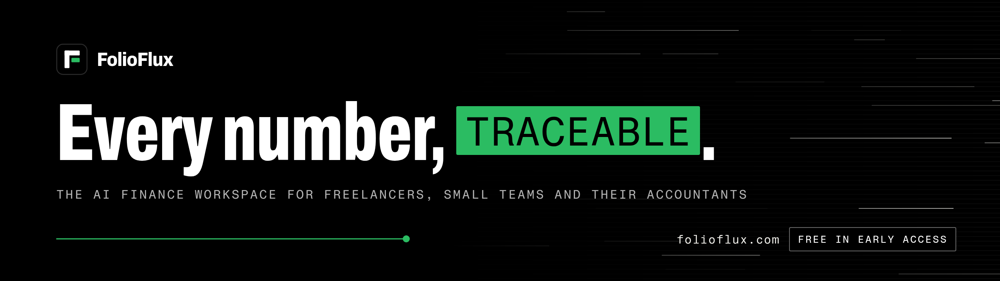
</a>

# FolioFlux brand kit

Logos, colors, type and banner templates for [FolioFlux](https://folioflux.com), the AI finance workspace for freelancers, small teams and their accountants. FolioFlux is free during early access.

Use these files when you write about FolioFlux, link to it or list it as a partner. If you need something that isn't here, write to [hello@folioflux.com](mailto:hello@folioflux.com).

**Contents:** [Logo](#logo) · [Colors](#colors) · [Typography](#typography) · [Usage](#usage) · [Banners](#banners) · [Downloads](#downloads) · [Press & partners](#press--partners) · [License](#license)

## Logo

The mark is an F on a black tile. Its middle bar is detached and green: a ledger row moving into place. The lockup sets the wordmark "FolioFlux" in Archivo ExtraBold beside it.

| On dark | On light |
| :---: | :---: |
| 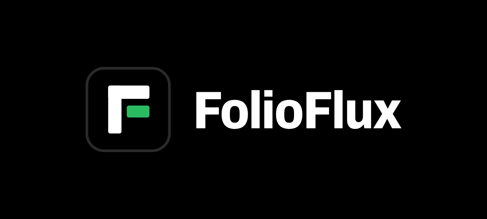 | 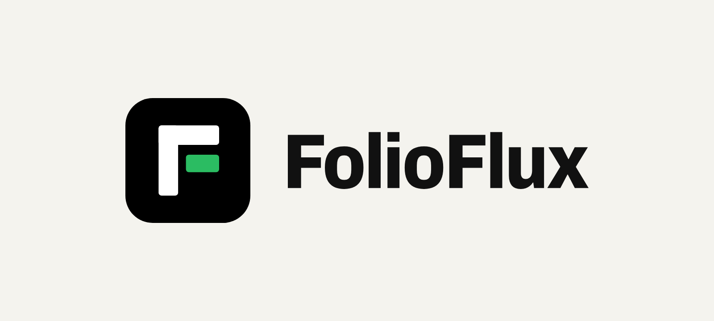 |
| [`folioflux-lockup-on-dark.svg`](logo/svg/folioflux-lockup-on-dark.svg) | [`folioflux-lockup-on-light.svg`](logo/svg/folioflux-lockup-on-light.svg) |

| File | Use |
| --- | --- |
| [`folioflux-mark.svg`](logo/svg/folioflux-mark.svg) | The mark. Light and mid-tone backgrounds. |
| [`folioflux-mark-on-dark.svg`](logo/svg/folioflux-mark-on-dark.svg) | The mark with a `#2A2A2A` hairline, so the tile keeps its edge on black. |
| [`folioflux-mark-square.svg`](logo/svg/folioflux-mark-square.svg) | Full-bleed square for avatars. Platforms round or crop it themselves. |
| [`folioflux-lockup-on-dark.svg`](logo/svg/folioflux-lockup-on-dark.svg), [`-on-light.svg`](logo/svg/folioflux-lockup-on-light.svg) | Mark and wordmark. White wordmark on dark, ink `#111111` on light. |
| [`folioflux-wordmark-white.svg`](logo/svg/folioflux-wordmark-white.svg), [`-ink.svg`](logo/svg/folioflux-wordmark-ink.svg) | The wordmark alone, for places that already show the mark. |

The SVGs are self-contained: the wordmark is outlined, so no font is needed. PNG exports are in [`logo/png`](logo/png):

- Mark: 16, 32, 64, 128, 256, 512 and 1024 px (transparent corners), and on-dark at 128, 512 and 1024 px.
- Avatar: 400 and 1024 px (full-bleed black square, for LinkedIn, X and GitHub).
- Lockups: 64, 128 and 256 px tall, on dark and on light (transparent background).

## Colors

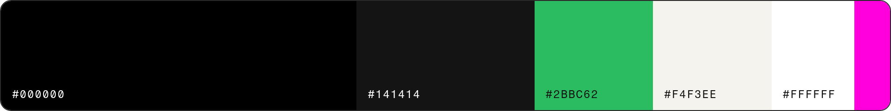

FolioFlux is black first. Green marks the one action that matters. Magenta is a rare accent.

| | Name | Hex | Use |
| --- | --- | --- | --- |
| 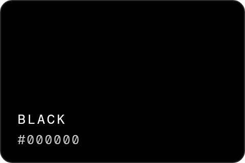 | Black | `#000000` | Canvas. The default background. |
| 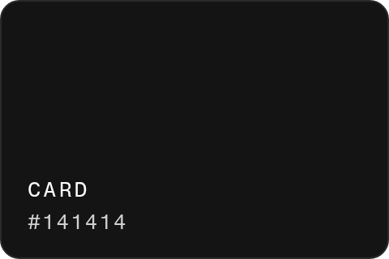 | Card | `#141414` | Cards, tables and panels on black. |
| 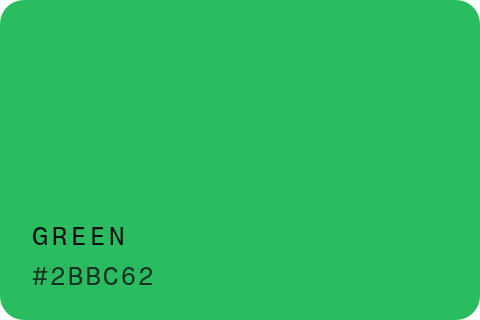 | Green | `#2BBC62` | Brand color. One primary action per area, threads, the bar in the mark. Black labels. |
| 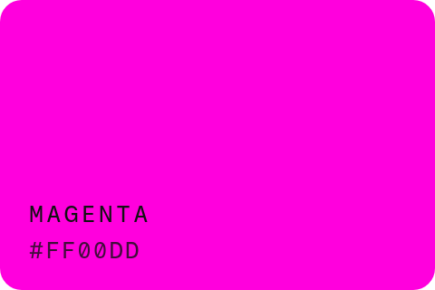 | Magenta | `#FF00DD` | Accent. **At most once** per image or screen, usually the highlight word. Black labels. |
| 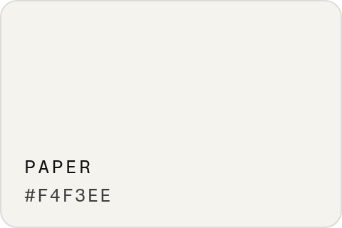 | Paper | `#F4F3EE` | Light background and receipt-paper cards. |
| 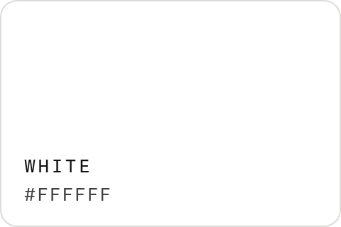 | White | `#FFFFFF` | Text on black, the F of the mark. |

<details>
<summary>Supporting colors</summary>

| | Name | Hex | Use |
| --- | --- | --- | --- |
| 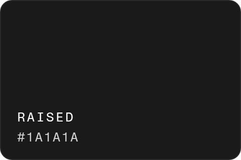 | Raised | `#1A1A1A` | Raised or hovered surface on dark. |
| 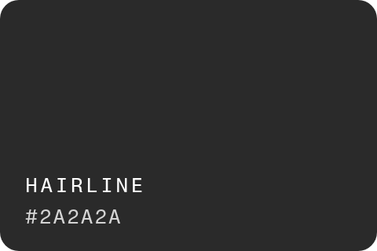 | Hairline | `#2A2A2A` | Dividers on dark; the outline of the mark on black. |
| 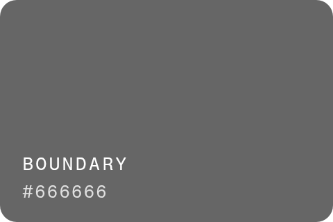 | Boundary | `#666666` | Control edges and outline tags on dark. |
| 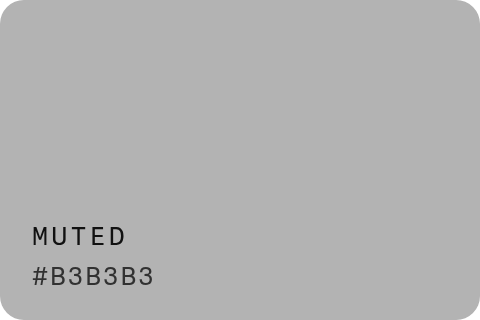 | Muted | `#B3B3B3` | Muted text and mono labels on dark. |
| 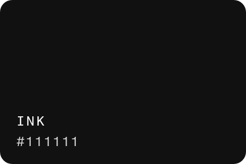 | Ink | `#111111` | Text on paper and light backgrounds. |
| 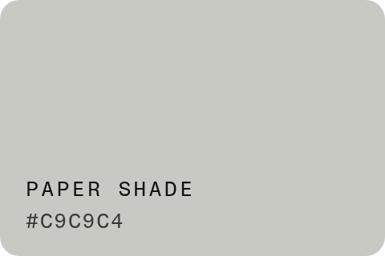 | Paper shade | `#C9C9C4` | Grey end of the paper gradient; ledger lines. |
| 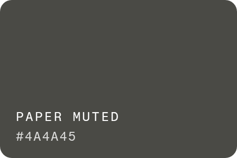 | Paper muted | `#4A4A45` | Muted text on paper. |
| 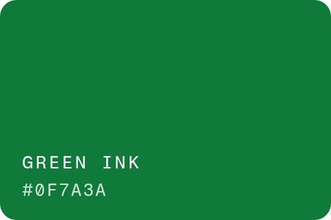 | Green ink | `#0F7A3A` | Green as text or a stamp on light backgrounds. |
| 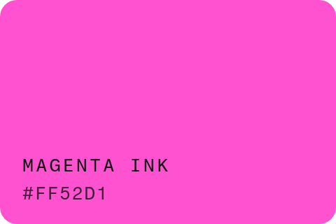 | Magenta ink | `#FF52D1` | Magenta as text on dark. |
| 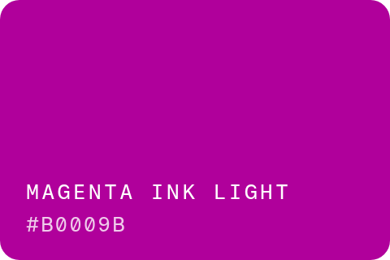 | Magenta ink (light) | `#B0009B` | Magenta as text on light. |

</details>

Tokens for code:

- [`colors/tokens.json`](colors/tokens.json): colors, light and dark theme roles, fonts, radii, spacing and logo rules, in the [Design Tokens](https://tr.designtokens.org/format/) format.
- [`colors/tokens.css`](colors/tokens.css): the same as CSS custom properties (`--ff-green`, `--ff-paper`, …), plus theme roles (`--ff-ui-canvas`, `--ff-ui-text`, `--ff-ui-brand`, …) that switch with `[data-theme="light"]` and `[data-theme="dark"]` (dark is the default).

```css
@import url("tokens.css");
.cta { background: var(--ff-green); color: var(--ff-black); border-radius: var(--ff-radius-pill); }
```

Two rules for color: labels on green or magenta are always black (white on them fails contrast), and green is the brand, not a signal for "profit" or "good".

## Typography

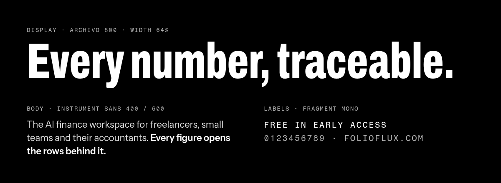

| Role | Typeface | Settings | Get it |
| --- | --- | --- | --- |
| Display, headlines, wordmark | **Archivo** | 800, compressed through the width axis (62–80%) for headlines, 87.5% (SemiCondensed) for the wordmark | [Google Fonts](https://fonts.google.com/specimen/Archivo) |
| Body, UI, data | **Instrument Sans** | 400 for text, 600 for emphasis and buttons | [Google Fonts](https://fonts.google.com/specimen/Instrument+Sans) |
| Labels, tags, highlight word | **Fragment Mono** | 400, uppercase, tracked 0.12em | [Google Fonts](https://fonts.google.com/specimen/Fragment+Mono) |

All three are licensed under the [SIL Open Font License 1.1](https://openfontlicense.org), which allows redistribution, so the font files are included in [`typography/fonts`](typography/fonts) with their licenses in [`typography/licenses`](typography/licenses):

- `static/`: Archivo ExtraBold SemiCondensed, Instrument Sans Regular and SemiBold, Fragment Mono Regular.
- `variable/`: Archivo (`wght` 100–900, `wdth` 62–125) and Instrument Sans (`wght` 400–700, `wdth` 75–100).

On the web, load them from Google Fonts:

```html
<link rel="preconnect" href="https://fonts.googleapis.com">
<link rel="preconnect" href="https://fonts.gstatic.com" crossorigin>
<link href="https://fonts.googleapis.com/css2?family=Archivo:wdth,wght@62..125,800&family=Fragment+Mono&family=Instrument+Sans:wght@400;600&display=swap" rel="stylesheet">
```

**The highlight word.** One word in a headline can be set in Fragment Mono, uppercase, at half the size of its line, in a magenta box with black text: Every number, `TRACEABLE`. Use it once per image or screen, and then use no other magenta.

## Usage

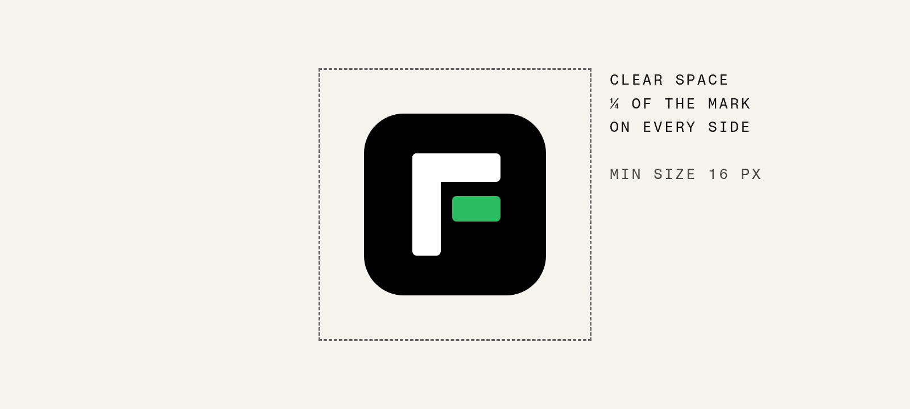

**Do**

- Keep clear space of at least **a quarter of the mark's height** on every side.
- Keep the mark at **16 px or larger**. Below that the bars blur together.
- Use the files in this repo as they are: black tile, white F, green bar.
- On black, use the on-dark mark or lockup, which carries a hairline so the tile keeps its edge.
- Write the name as **FolioFlux**: one word, capital F twice.
- Set the wordmark in Archivo ExtraBold, as in the lockup files.

**Don't**

- Recolor the mark or the wordmark, swap the green for magenta, or move the green bar.
- Stretch, squash, rotate, skew or crop the logo. Scale it proportionally.
- Add outlines, shadows, glows, gradients or effects, or place it on a busy photo.
- Set "FolioFlux" in another typeface or rebuild the lockup with different spacing.
- Use magenta more than once in a layout, or put white text on green or magenta.
- Use the name or logo in a way that suggests FolioFlux sponsors, endorses or partners with you, unless it does.

## Banners

Templates for profile covers and link previews, rendered from code (no stock or generated imagery): black canvas, Archivo headline, a magenta highlight word, a green thread and a ledger-line field.

| Template | File | Size | Notes |
| --- | --- | --- | --- |
| GitHub README / profile | [`github/folioflux-github-banner-1280x360@2x.png`](banners/github/folioflux-github-banner-1280x360@2x.png) | 2560×720 | Matches the [organization profile](https://github.com/folioflux) banner (green highlight). |
| GitHub social preview | [`github/folioflux-social-preview-1280x640.png`](banners/github/folioflux-social-preview-1280x640.png) | 1280×640 | Repository Settings › Social preview. |
| LinkedIn company cover | [`linkedin/folioflux-linkedin-cover-1128x191.png`](banners/linkedin/folioflux-linkedin-cover-1128x191.png), [`@2x`](banners/linkedin/folioflux-linkedin-cover-1128x191@2x.png) | 1128×191, 2256×382 | The left side stays clear of the page logo. |
| LinkedIn / X avatar | [`logo/png/folioflux-avatar-400.png`](logo/png/folioflux-avatar-400.png) | 400×400 | Full-bleed mark. |
| X header | [`x/folioflux-x-header-1500x500.png`](banners/x/folioflux-x-header-1500x500.png) | 1500×500 | Copy sits centre-right, clear of the avatar and the mobile crop. |
| Open Graph | [`og/folioflux-og-1200x630.png`](banners/og/folioflux-og-1200x630.png) | 1200×630 | Link previews on the web, LinkedIn, X, Slack. |

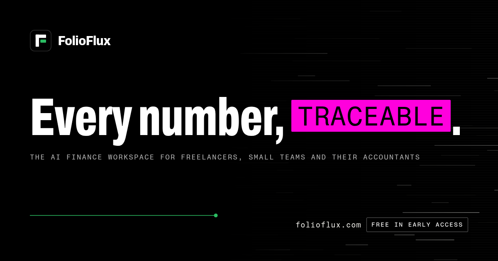 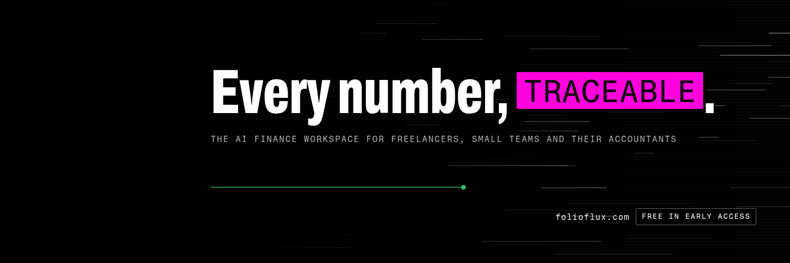

To change the copy or render new sizes, edit the constants at the top of [`banners/generate.py`](banners/generate.py) and run it. It needs Python 3 and Google Chrome or Chromium, and uses only the fonts in this repo:

```sh
python3 banners/generate.py          # every template
python3 banners/generate.py og x     # just these
```

The logo exports, swatches, specimen and `tokens.css` come from [`scripts/build_kit.py`](scripts/build_kit.py) (`pip install fonttools uharfbuzz pillow`, then `python3 scripts/build_kit.py`). Edit [`colors/tokens.json`](colors/tokens.json), not the generated files.

## Downloads

| What | Where |
| --- | --- |
| Everything | [Download ZIP](https://github.com/folioflux/brand/archive/refs/heads/main.zip) |
| Logos (SVG) | [`logo/svg`](logo/svg) |
| Logos (PNG) | [`logo/png`](logo/png) |
| Colors and tokens | [`colors`](colors) |
| Fonts and licenses | [`typography`](typography) |
| Banners and social templates | [`banners`](banners) |

## Press & partners

Writing about FolioFlux, listing it in a directory or partnering with us? Use the files above as they are. For anything else, such as a quote, product screenshots or co-branded material, email [hello@folioflux.com](mailto:hello@folioflux.com).

- **Name:** FolioFlux
- **What it is:** an AI finance workspace for freelancers, small teams and their accountants
- **Availability:** free during early access
- **Founder & CEO:** Andrii Furmanets
- **Website:** [folioflux.com](https://folioflux.com)

## License

The code and scripts in this repository (`banners/generate.py`, `scripts/`, `colors/tokens.css` and `colors/tokens.json`) are released under the [MIT License](LICENSE). The fonts are under the SIL Open Font License 1.1; see [`typography/licenses`](typography/licenses).

**Trademark notice.** The FolioFlux name and logo are trademarks of FolioFlux. The MIT License does not grant any right to use them. You may use the logos, banners and other assets in this repository to refer to FolioFlux, for example in articles, directories, integration listings and links, as long as you follow the usage guidelines above. You may not use them to imply that FolioFlux sponsors or endorses you, your product or your content, as part of your own product or company name, or in a modified form.
